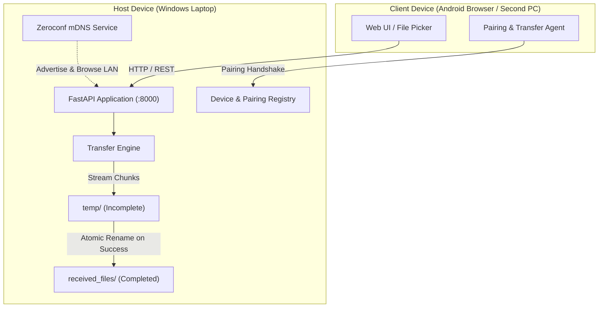
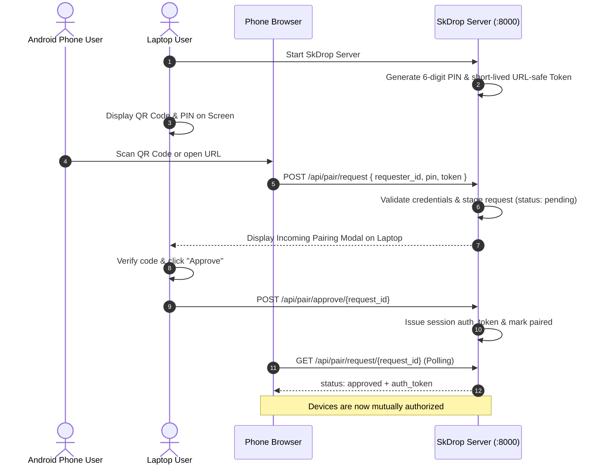

# SkDrop Architecture & Protocol Specification

## Overview

SkDrop provides AirDrop-inspired local-network file transfer between Windows laptops and Android devices over Wi-Fi and mobile hotspots.



---

## 1. Device Pairing Sequence (Mutual Authorization)

SkDrop does not treat discovering an IP address as proof of authorization. Pairing requires explicit receiver approval:



---

## 2. Phone → Laptop Upload Pipeline

```mermaid
sequenceDiagram
    autonumber
    actor User as Phone User
    participant Browser as Mobile Browser
    participant Server as FastAPI Server
    participant Storage as File Storage (temp/ & received_files/)

    User->>Browser: Select photos/documents (multi-file supported)
    loop For Each File
        Browser->>Browser: Validate file size <= 100 MB
        Browser->>Server: POST /api/upload (Multipart stream)
        activate Server
        Server->>Storage: Stream chunks into temp/upload_{uuid}_{clean_name}
        Server->>Server: Track chunk size; enforce MAX_FILE_SIZE
        alt Exceeds size limit
            Server->>Storage: Unlink partial temp file
            Server-->>Browser: 413 Payload Too Large
        else Successful Stream
            Server->>Storage: Atomic move to received_files/{clean_name (n)}
            Server->>Server: Generate file_id & register metadata
            Server-->>Browser: 200 OK { id, name, size, timestamp }
        end
        deactivate Server
        Browser->>Browser: Update per-file progress to 100%
    end
    Browser->>Server: GET /api/files
    Server-->>Browser: Updated received files list
```

---

## 3. Laptop → Android Phone Transfer Pipeline

Mobile browsers (Chrome/Firefox on Android) do not expose an open listening socket on port 8000. SkDrop handles Laptop-to-Phone transfer through an interactive receiver offer flow:

1. **Sender Staging**: Laptop user selects paired phone and picks a file. The laptop server registers an outgoing transfer offer for that client ID.
2. **Receiver Notification**: The phone browser's active SkDrop tab detects the pending transfer.
3. **Receiver Approval**: A prompt appears on the phone: `Laptop is sending photo.jpg (2.4 MB). Accept & Download?`
4. **Streaming Download**: If approved, the phone browser initiates a stream from `/api/download/{file_id}`, saving the file to Android's `Downloads` folder.

---

## Security Model

- **No Arbitrary Paths**: Downloads use opaque server-generated UUIDs (`/api/download/{file_id}`). Paths are validated using `Path.resolve()` to prevent traversal.
- **Filename Sanitization**: Directory components, null bytes, control codes, and Windows reserved characters (`<>:"/\|?*`) are removed.
- **Short-Lived Credentials**: Pairing PINs and tokens expire after 5 minutes.
- **Local Network Scope**: SkDrop is designed for trusted local Wi-Fi or mobile hotspots. Ordinary HTTP traffic over LAN is unencrypted.
